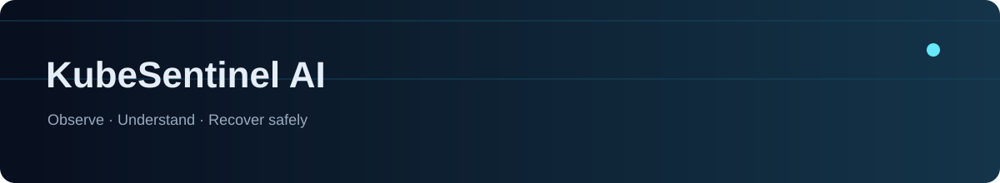
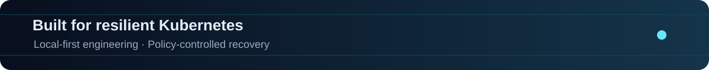

# KubeSentinel AI



Local full-stack foundation for a planned AI-powered, safely self-healing Kubernetes platform.

**Current status: Phase 06 guarded local recovery in development.** This branch includes the dashboard/API/worker, Compose and kind/Helm definitions, AWS Terraform source, observability/incident ingestion, causal features and rules/statistical/Isolation Forest scoring. The ML evaluation uses explicitly **synthetic** telemetry and does not establish real-cluster accuracy. Rules remain the detector default; no model executes remediation. See the [Phase 05 guide](docs/runbooks/anomaly-detection.md), [model card](ml/models/model-card.md) and [ML verification](docs/reports/phase-05-validation.md). The separately scoped recovery operator is described below. Production identity and promotion remain future work. AWS infrastructure has **not** been deployed.

**Phase 06 adds an isolated, policy-driven recovery operator verified in Linux kind CI.** It defaults to dry-run, scopes execution to named opted-in Deployments, requires signed approvals for risky actions, and verifies recovery before success. Actual fault tests passed approved rollback, bounded scale-up, verified undo and safety rejection. No ML/LLM output can directly execute actions. See the [operator guide](docs/runbooks/recovery-operator.md), [safety architecture](docs/architecture/recovery-operator.md) and [actual validation status](docs/reports/phase-06-validation.md). This is not production authorization or an AWS deployment.

The repository is now [KubeSentinel-AI](https://github.com/manikantbindass/KubeSentinel-AI). The original Apache 2.0 license and Git history are preserved. See the [repository audit](docs/repository-audit.md).

## Start here

- [System architecture and technology choices](docs/architecture/system-overview.md)
- [C4 diagrams and data flows](docs/diagrams/README.md)
- [Development guide: Windows and Linux/macOS](docs/development-guide.md)
- [Roadmap and phase acceptance gates](docs/roadmap.md)
- [Threat model](docs/security/threat-model.md)
- [AWS cost considerations](docs/costs/aws-cost-considerations.md)
- [Architecture decisions](docs/architecture/README.md)
- [Validation results and blockers](docs/validation.md)

## Planned platform

Next.js/TypeScript/Tailwind dashboard; FastAPI backend; OIDC authentication and scoped authorization; telemetry ingestion; PostgreSQL for incidents/policies/audit; Redis for transient coordination; Prometheus and a log store for observability; anomaly detection and incident correlation; a default-deny remediation policy engine; a least-privilege Kubernetes operator; notifications; optional evidence-grounded AI assistance; and a separately authorized AWS EKS deployment managed through Terraform, Helm, and Argo CD.

The larger platform is a target design. Implemented local components are listed above; alternatives, trust boundaries, and deployment stages are documented in the system overview.

## Repository layout

| Directory | Responsibility |
| --- | --- |
| `apps/` | Running dashboard/API and worker; future isolated fault workload |
| `services/` | Advisory anomaly detector and responsibility notes for future domain services |
| `operator/` | Guarded Go recovery controller, typed CRDs, approval CLI, safety tests and isolated lab |
| `ml/` | Dataset governance, features, training, evaluation, model lineage |
| `infrastructure/` | Local Kubernetes/Helm, observability stack and undeployed AWS Terraform source |
| `docs/` | Audit, C4 architecture, ADRs, roadmap, development, security, costs, validation |
| `scripts/` | Foundation validation tooling and future development automation |
| `tests/` | Application, migration, feature, model and integration tests |
| `.github/` | Application, Kubernetes, Terraform, observability and ML checks |

Responsibility notes identify future components without empty placeholder files. No cloud manifests or fabricated report/presentation binaries are included.

## Run locally

Phase 03 adds [AWS EKS Terraform infrastructure code](infrastructure/terraform/README.md): networking, EKS, IAM/Pod Identity, ECR, logging and optional existing-LB DNS modules, dev/demo profiles and separate encrypted state bootstrap. **No AWS resources are deployed and no live plan/apply/destroy has been run.** See the [operator gates](docs/runbooks/aws-eks.md), [cost assumptions](docs/costs/eks-estimate.md) and [validation record](docs/reports/phase-03-validation.md).

For kind and Helm orchestration, see the [local Kubernetes guide](docs/runbooks/local-kubernetes.md). Phase 02 adds scoped bootstrap/build/scan/cleanup scripts, chart profiles and deployment tests. Linux CI verified fresh-cluster deployment and smoke tests; Windows Docker remains unavailable locally. Image scans contain HIGH/CRITICAL findings; see the [validation and security follow-up](docs/reports/phase-02-validation.md) before promotion. Animated SVG banners use local assets and offer a static treatment for reduced-motion preferences where supported.

Install Docker Engine + Compose v2 (Linux) or Docker Desktop using **Linux containers** (Windows/macOS). From the repository root:

```sh
# Linux/macOS
cp .env.example .env
docker compose up --build --wait --wait-timeout 180
python3 scripts/setup/smoke.py
```

```powershell
# Windows PowerShell
Copy-Item .env.example .env
docker compose up --build --wait --wait-timeout 180
py -3.12 scripts/setup/smoke.py
```

Open [dashboard](http://localhost:3000), [health](http://localhost:8000/api/v1/health), [readiness](http://localhost:8000/api/v1/ready), or [OpenAPI docs](http://localhost:8000/docs). Queue a greeting in the dashboard; the worker completes it and the result persists in PostgreSQL. The one-shot migrator must complete before the API and worker start. Containers publish only loopback ports. This unauthenticated demo is for trusted local development, not public exposure.

See the [development guide](docs/development-guide.md) for native hot reload, Compose hot reload, all configuration, API examples, database tests, cleanup, and troubleshooting. Commands are provided for Windows and Linux/macOS. The [service diagram](docs/diagrams/local-services.mmd) shows actual local dependencies.

## Verify

Use Node **24.14.1**, npm **11.11.0**, Python **3.12** (project supports 3.12-3.14; local validation uses 3.12), and uv **0.13.6**. Application and tooling versions are explicit; npm/uv lockfiles pin transitive dependencies.

```sh
npm ci
uv sync --frozen
npm run lint
npm run typecheck
npm test
npm run build
uv run ruff check .
uv run ruff format --check .
uv run mypy
uv run pytest
npm run lint:docs
npm run diagrams
uv run python scripts/validate_repository.py
```

Make targets: `setup`, `dev`, `test`, `lint`, `build`, `clean`, `health`, plus `check` and `migrate`. Make is optional on Windows; every underlying command is in the development guide. Migration tests require an explicitly disposable PostgreSQL database ending in `_test`; absent that configuration they skip visibly. See the [verification record](docs/validation.md) for exact results and blockers. No AWS resource is provisioned.

## Collaboration

Read [CONTRIBUTING](CONTRIBUTING.md), [CODE_OF_CONDUCT](CODE_OF_CONDUCT.md), [SECURITY](SECURITY.md), and [CHANGELOG](CHANGELOG.md). Branch from `main` using `feat/`, `fix/`, `docs/`, `chore/`, or `ci/` and use Conventional Commits. Preserve [LICENSE](LICENSE) and existing Git ancestry.


