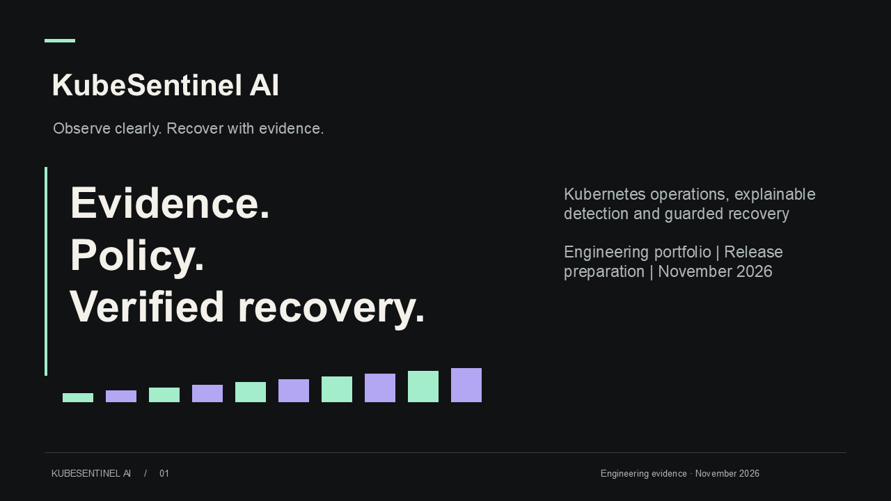
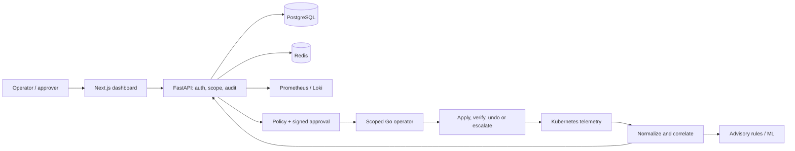
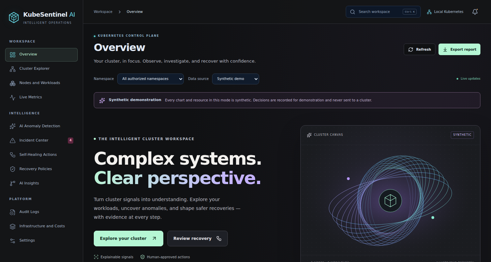
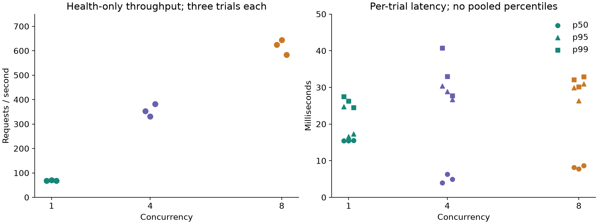

# KubeSentinel AI


**Observe clearly. Recover with evidence.**

A Kubernetes operations platform with a real full-stack dashboard, explainable anomaly detection and a policy-driven recovery operator. Detection supplies evidence; deterministic policy and human approval control execution.

[](https://github.com/manikantbindass/KubeSentinel-AI/actions/workflows/checks.yml)
[](https://github.com/manikantbindass/KubeSentinel-AI/actions/workflows/security.yml)
[](LICENSE)

**Release status:** development portfolio; v1.0.0 is unpublished and blocked by security findings. Local and Linux CI evidence exists for selected flows. AWS is **not deployed**. Synthetic evaluations and demo telemetry do not establish production accuracy or readiness. See the [release checklist](docs/releases/v1.0.0-candidate.md) and [dated validation matrix](docs/reports/phase-11-validation.md).

## Presentation and technical report

[](KubeSentinel-AI-Presentation.pptx)

**[Download editable PowerPoint](KubeSentinel-AI-Presentation.pptx)** · [View slides as PDF](docs/presentations/KubeSentinel-AI-Presentation.pdf) · **[Download technical report](KubeSentinel-AI-Technical-Report.pdf)**

The presentation includes speaker notes and editable charts. The report covers architecture, implementation, safety, experiments, costs and limitations. [Reproducible documentation sources](docs/portfolio/README.md) include chart inputs and SHA-256 provenance.

## What works, and what remains

| Capability | State | Evidence / limit |
| --- | --- | --- |
| Next.js, FastAPI, PostgreSQL, Redis | Implemented locally / CI | [Development guide](docs/development-guide.md); health, readiness, migrations and durable greeting queue |
| Operations workspace, scoped API, audit and live updates | Implemented locally / CI | [Operations guide](docs/runbooks/operations-dashboard.md); twelve sections, real mode default, explicit synthetic partition |
| kind, Helm, probes, RBAC and isolation | Implemented / CI tested | [Local Kubernetes](docs/runbooks/local-kubernetes.md); check current CI before promotion |
| Prometheus, Loki, OTel, Grafana, incident ingestion | Implemented / CI tested | [Observability](docs/runbooks/observability.md); environment sizing and HA remain open |
| Rules, robust statistics, Isolation Forest | Experimental | [Model card](ml/models/model-card.md); small synthetic evaluation, uncalibrated scores |
| Policy-driven recovery controller | Implemented in isolated lab | [Operator guide](docs/runbooks/recovery-operator.md); dry-run default, signed approval, bounded actions and verification |
| Correlation and runbook retrieval | Experimental | [AIOps guide](docs/runbooks/aiops-investigation.md); synthetic contracts; no remote LLM |
| Supply-chain checks and GitOps source | Implemented; delivery gated | [Secure delivery](docs/runbooks/secure-delivery.md); vulnerabilities block release; no live ECR/Argo promotion |
| Load and resilience tooling | Partial evidence | [Resilience](docs/runbooks/resilience.md); health-only load results; broader chaos/scaling pending |
| AWS EKS Terraform | Validated source; undeployed | [AWS guide](docs/runbooks/aws-eks.md); paid resources require authorization |
| Production certification, real-label ML, HA/DR, multi-cluster | Planned | [Roadmap](docs/roadmap.md) and release gates |

## Architecture



The browser receives no Kubernetes credentials. The operator independently checks scope, workload identity, approval and safety constraints. ML/LLM output cannot directly execute changes. [C4 sources](docs/diagrams/README.md), [system design](docs/architecture/system-overview.md), [recovery architecture](docs/architecture/recovery-operator.md) and [threat model](docs/security/threat-model.md) explain the boundaries. Terraform owns cloud prerequisites; Argo CD owns reviewed application configuration.

## Quickstart: local vertical slice

Install Docker Engine + Compose v2 on Linux, or Docker Desktop using **Linux containers** on Windows/macOS. No AWS account is required.

```sh
# Linux/macOS, from the repository root
cp .env.example .env
docker compose up --build --wait --wait-timeout 180
python3 scripts/setup/smoke.py
```

```powershell
# Windows PowerShell, from the repository root
Copy-Item .env.example .env
docker compose up --build --wait --wait-timeout 180
py -3.12 scripts/setup/smoke.py
```

Open [status and greeting demo](http://localhost:3000/status), [health](http://localhost:8000/api/v1/health), [readiness](http://localhost:8000/api/v1/ready) and [OpenAPI](http://localhost:8000/docs). The migrator must finish before API/worker startup. Ports bind to loopback. This unauthenticated greeting slice is for trusted local development.

For the **full operations dashboard at `/`**, follow the [Windows/Linux/macOS operations setup](docs/runbooks/operations-dashboard.md). It generates local credentials/signing material, configures the Compose overlay and explains OIDC, real collection and optional labeled demo seeding. A fresh real installation stays empty until telemetry is collected. The documented native launcher uses port 4317 to avoid common Windows port conflicts.

[Native/hot-reload setup](docs/development-guide.md) · [kind and Helm deployment](docs/runbooks/local-kubernetes.md) · [Helm values](infrastructure/helm/kubesentinel/values.yaml) · [AWS and teardown gates](docs/runbooks/aws-eks.md)

## Actual application screenshot



This actual application capture comes from the [Phase 07 browser run](docs/reports/phase-07/browser-results.json), with **synthetic demo telemetry** visibly labeled. It is not production data. [Desktop](docs/screenshots/phase-07/desktop.png), [tablet](docs/screenshots/phase-07/tablet.png), [mobile](docs/screenshots/phase-07/mobile.png) and [monitoring screenshots with provenance](docs/screenshots/observability/README.md) are available.

## Evidence and benchmarks

| Experiment | Recorded result | Interpretation |
| --- | --- | --- |
| [Detector evaluation](docs/reports/phase-05/evaluation.json) | 177 synthetic held-out windows, two incidents; rules P/R 1.00/1.00; forest 0.667/0.90 | Tiny generated distribution; no production accuracy estimate |
| [Isolated kind recovery](docs/reports/phase-06/all-actions.json) | Eight action records: two succeeded, four rejected, one dry-run, one rolled back | Safety outcomes; not eight independent recovery trials |
| [Approved scale](docs/reports/phase-06/approved-scale.json) | 10 s observation-to-apply; 36 s verification | One sample, including human approval/polling; no SLA or native baseline |
| [Loopback health load](docs/benchmarks/phase-09/loopback/summary.json) | 900 requests, concurrency 1/4/8, three repetitions; trial p95 16.6–31.0 ms; zero sample errors | Windows HTTP health only; no DB/cluster capacity claim |
| [Correlation/retrieval](docs/reports/phase-10/results.json) | Eight synthetic incidents, 12 expected directed links, 8/8 retrieval matches | Contract evaluation; no real-world root-cause accuracy claim |



CPU/memory overhead, repeated native-versus-KubeSentinel recovery, full-stack saturation and HPA curves are **planned experiments**, with no invented values. [Cost scenarios](docs/costs/eks-estimate.md) use rounded assumptions, exclude major services, and are not current AWS quotes.

## Validate and contribute

Toolchain: Node **24.14.1**, npm **11.11.0**, Python **3.12**, uv **0.13.6**. Explicit dependencies and transitive locks are committed. Go, Terraform, Helm and security tool pins live with their workflows/configuration.

```sh
npm ci
uv sync --frozen --extra ml --extra ops
npm run lint
npm run typecheck
npm test
npm run build
uv run ruff check .
uv run ruff format --check .
uv run mypy
uv run pytest -m 'not postgres'
npm run lint:docs
npm run diagrams
uv run python scripts/validate_repository.py
```

Migration tests separately require a disposable PostgreSQL database ending in `_test`. Container, browser and cluster checks require documented dependencies; [validation results](docs/reports/phase-11-validation.md) distinguish current local checks from historical CI. Make targets include `setup`, `dev`, `test`, `lint`, `build`, `clean` and `health`; Make is optional on Windows.

Read [CONTRIBUTING](CONTRIBUTING.md), [SECURITY](SECURITY.md), [CODE_OF_CONDUCT](CODE_OF_CONDUCT.md) and [CHANGELOG](CHANGELOG.md). Use reviewed feature branches and Conventional Commits. [Release notes and gates](docs/releases/v1.0.0-candidate.md) are prepared; no merge or release publication is authorized by this documentation change.

## Repository map and license

| Path | Responsibility |
| --- | --- |
| `apps/`, `services/` | Dashboard, API, worker, demo workload and advisory detector |
| `operator/` | Go reconciliation, CRDs, scoped RBAC and recovery lab |
| `ml/` | Features, training, evaluation, metadata and model limitations |
| `infrastructure/` | kind/Helm, monitoring, GitOps, admission examples and undeployed Terraform |
| `docs/`, `scripts/`, `tests/`, `.github/` | Architecture, runbooks, portfolio sources, automation and validation |

The repository was renamed to **KubeSentinel-AI** with its original history and [Apache 2.0 LICENSE](LICENSE) preserved. See the [initial audit](docs/repository-audit.md). Thanks to the Kubernetes/CNCF, Python, Go and React/Next.js communities and tool maintainers. Third-party components retain their own licenses.


