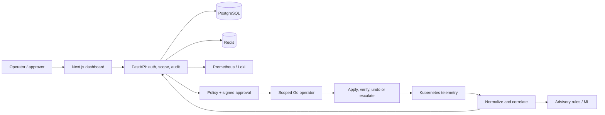

# KubeSentinel AI


**Observe clearly. Recover with evidence.**

A Kubernetes operations platform with a real full-stack dashboard, explainable anomaly detection and a policy-driven recovery operator. Detection supplies evidence; deterministic policy and human approval control execution.

[](https://github.com/manikantbindass/KubeSentinel-AI/actions/workflows/checks.yml)
[](https://github.com/manikantbindass/KubeSentinel-AI/actions/workflows/security.yml)
[](LICENSE)

**Release status:** development portfolio; v1.0.0 is unpublished. The latest [security remediation](docs/reports/release-audit/security-remediation.json) passes source and all five image gates with no HIGH/CRITICAL findings; final integration checks and the remaining release acceptance criteria still apply. Local and Linux CI evidence exists for selected flows. AWS is **not deployed**. Synthetic evaluations and demo telemetry do not establish production accuracy or readiness. See the [release checklist](docs/releases/v1.0.0-candidate.md) and [dated validation matrix](docs/reports/phase-11-validation.md).

See the [phase completion and release audit](docs/audits/PHASE_COMPLETION_AUDIT.md) for current findings and merge gates.

## Presentation and technical report

[](KubeSentinel-AI-Presentation.pptx)

**[Download editable PowerPoint](KubeSentinel-AI-Presentation.pptx)** · [View slides as PDF](docs/presentations/KubeSentinel-AI-Presentation.pdf) · **[Download technical report](KubeSentinel-AI-Technical-Report.pdf)**

The presentation includes speaker notes and editable charts. The report covers architecture, implementation, safety, experiments, costs and limitations. [Reproducible documentation sources](docs/portfolio/README.md) include chart inputs and SHA-256 provenance. These portfolio artifacts describe their recorded source snapshot; later extensions are documented in the current code, runbooks and changelog.

## Contents

- [Project purpose](#project-purpose)
- [Implemented capabilities and limits](#what-works-and-what-remains)
- [Architecture and data flow](#architecture)
- [Dashboard workspace](#dashboard-workspace)
- [Windows CMD installation](#easy-windows-cmd-installation)
- [Local quickstart and configuration](#quickstart-local-vertical-slice)
- [API examples](#api-examples)
- [Kubernetes and recovery safety](#kubernetes-and-recovery-safety)
- [Anomaly detection and incident investigation](#anomaly-detection-and-incident-investigation)
- [Secure escalation delivery](#secure-escalation-delivery)
- [Screenshots and measured results](#evidence-and-benchmarks)
- [Tests and contribution](#validate-and-contribute)
- [Troubleshooting](#troubleshooting)
- [Future scope and documentation](#future-scope-and-documentation)

## Project purpose

KubeSentinel AI helps an operator answer three questions: **what changed, what
evidence explains the incident, and which recovery action is permitted?** It
combines an operations interface with telemetry ingestion, advisory anomaly
detection, incident investigation and a separately governed recovery controller.

The project extends Kubernetes reconciliation with explicit policy and evidence.
It does not replace the scheduler, Deployment controller, monitoring stack or
human incident commander. A high anomaly score is a signal to investigate;
successful execution of an API patch is not sufficient evidence of recovery.

**Use it for:** local full-stack development, isolated Kubernetes experiments,
policy/approval demonstrations, reproducible synthetic ML evaluation, and review
of infrastructure and delivery design. The repository contains a working
development platform with selected CI acceptance evidence; it does not claim
production certification, a live EKS deployment or independently established
real-world model accuracy.

## What works, and what remains

| Capability | State | Evidence / limit |
| --- | --- | --- |
| Next.js, FastAPI, PostgreSQL, Redis | Implemented locally / CI | [Development guide](docs/development-guide.md); health, readiness, migrations and durable greeting queue |
| Operations workspace, scoped API, audit and live updates | Implemented locally / CI | [Operations guide](docs/runbooks/operations-dashboard.md); twelve sections, real mode default, explicit synthetic partition |
| kind, Helm, probes, RBAC and isolation | Implemented / CI tested | [Local Kubernetes](docs/runbooks/local-kubernetes.md); check current CI before promotion |
| Prometheus, Loki, OTel, Grafana, incident ingestion | Implemented / CI tested | [Observability](docs/runbooks/observability.md); environment sizing and HA remain open |
| Rules, robust statistics, Isolation Forest | Experimental | [Model card](ml/models/model-card.md); small synthetic evaluation, uncalibrated scores |
| Policy-driven recovery controller | Implemented in isolated lab | [Operator guide](docs/runbooks/recovery-operator.md); dry-run default, signed approval, bounded actions and verification |
| Correlation and runbook retrieval | Experimental | [AIOps guide](docs/runbooks/aiops-investigation.md); synthetic contracts; no remote LLM |
| Signed recovery escalation webhooks | Opt-in extension | [Webhook setup](docs/runbooks/escalation-webhooks.md); durable outbox, bounded retries, audit, demo isolation; no remediation authority |
| Supply-chain checks and GitOps source | Implemented; delivery gated | [Secure delivery](docs/runbooks/secure-delivery.md); vulnerabilities block release; no live ECR/Argo promotion |
| Load and resilience tooling | Partial evidence | [Resilience](docs/runbooks/resilience.md); health-only load results; broader chaos/scaling pending |
| AWS EKS Terraform | Validated source; undeployed | [AWS guide](docs/runbooks/aws-eks.md); paid resources require authorization |
| Production certification, real-label ML, HA/DR, multi-cluster | Planned | [Roadmap](docs/roadmap.md) and release gates |

## Architecture



The browser receives no Kubernetes credentials. The operator independently checks scope, workload identity, approval and safety constraints. ML/LLM output cannot directly execute changes. [C4 sources](docs/diagrams/README.md), [system design](docs/architecture/system-overview.md), [recovery architecture](docs/architecture/recovery-operator.md) and [threat model](docs/security/threat-model.md) explain the boundaries. Terraform owns cloud prerequisites; Argo CD owns reviewed application configuration.

### Technology and responsibility

| Layer | Technology | Responsibility |
| --- | --- | --- |
| Dashboard | Next.js App Router, TypeScript, Tailwind, reusable UI components, TanStack Query | Responsive operations views, scoped API requests, polling/live updates and explicit data states |
| Backend | FastAPI, Pydantic, SQLAlchemy, Alembic | Versioned APIs, validation, authorization, persistent records and migrations |
| Durable store | PostgreSQL | Incidents, operations snapshots, decision commands, audit and escalation delivery state |
| Coordination | Redis and SQL-backed worker | Cache, bounded wake-up hints, mutation limits and durable background work |
| Telemetry | Prometheus, kube-state-metrics, Loki, OpenTelemetry Collector, Grafana, Alertmanager | Metrics, logs, traces, dashboards and alert ingestion |
| Detection | Rules, robust statistics, Isolation Forest | Windowed advisory scores, data-quality flags, model lineage and explanations |
| Recovery | Go controller, Kubernetes CRDs, Ed25519 plan approvals | Scoped reconciliation, deterministic guards, verified actions and audit |
| Deployment | Docker Compose, kind, Helm | Local services, isolated cluster packaging, probes, resources and policies |
| Delivery | GitHub Actions, SBOM/scanning, Argo CD source, Terraform | Reviewed artifacts and gated delivery; cloud execution remains separately authorized |

Exact dependency selections live in [package.json](package.json),
[package-lock.json](package-lock.json), [pyproject.toml](pyproject.toml),
[uv.lock](uv.lock), [operator/go.mod](operator/go.mod) and
[operator/go.sum](operator/go.sum). Runtime images and delivery tools have
[reviewed pins](.github/security). Reproducible dependency selection does not
imply bit-identical builds or an indefinitely vulnerability-free image.

### How evidence becomes an action

1. Collect bounded Kubernetes resource/event snapshots and configured telemetry.
   Normalization preserves workload identity, time and source provenance.
2. Persist incidents and expose collected evidence through the API. Duplicate
   incident ingestion and heuristic related-incident grouping are separate paths.
3. Build consistent feature windows and produce advisory rule/statistical/model
   scores. Missing evidence remains unavailable rather than becoming healthy zero.
4. Evaluate a recovery policy against fresh native evidence, workload identity,
   scope, cooldown, budget and availability constraints. Request signed approval
   when required; default to dry-run.
5. Apply an allowed operation through the scoped controller, observe the rollout
   and service checks, and record success, rejection, rollback or escalation.
6. Mirror the resulting evidence to the dashboard. When explicitly configured,
   eligible real escalation phases enter the signed webhook outbox; notification
   retries cannot execute remediation.

This is the intended component flow. Archived tests exercise selected paths;
a continuous genuine-telemetry-to-ML-to-verified-recovery experiment remains a
separate acceptance requirement.

## Dashboard workspace

The operations dashboard is available at `/`; the initial connectivity slice
remains at `/status`. The twelve workspace sections provide:

| Section | What an operator can inspect or do |
| --- | --- |
| Overview | Health summaries, incident/workload evidence and recent activity |
| Cluster Explorer | Search/filter collected inventory and open resource details |
| Nodes and Workloads | Inspect node, pod and Deployment readiness/replica information |
| Live Metrics | Query fixed CPU, memory, request and latency histories |
| AI Anomaly Detection | Inspect scores, thresholds, provenance and feature deviations |
| Incident Center | Inspect affected workloads and add authorized review notes |
| Self-Healing Actions | Inspect exact plans, approval state, verification and rollback evidence |
| Recovery Policies | Inspect policies and submit bounded, server-authorized changes |
| AI Insights | Investigate heuristic relationships, hypotheses and retrieved runbooks |
| Audit Logs | Inspect decision and delivery records with actors and correlation IDs |
| Infrastructure and Costs | Inspect resource context and calculate user-entered cost scenarios |
| Settings | Save personal workspace preferences and inspect access/data configuration |

**Real mode is the default.** A fresh installation can be empty until collectors
are configured. Synthetic fixtures require an explicit demo setting and selector;
an unavailable data source does not silently switch to demo data. The illustrated
cluster geometry is artwork, not discovered network topology. Cost scenarios
are calculations from entered assumptions, not imported AWS bills.

See the [operations guide](docs/runbooks/operations-dashboard.md) for provider
configuration, bridge setup, UI behavior and current authorization limits.

## Easy Windows CMD installation

Install Git for Windows and Docker Desktop with a running Linux engine, then paste this into **Command Prompt** in a folder for a new checkout:

```bat
git clone --branch main https://github.com/manikantbindass/KubeSentinel-AI.git && cd KubeSentinel-AI && scripts\setup\install.cmd --demo
```

The installer is available on `main` following [PR #28](https://github.com/manikantbindass/KubeSentinel-AI/pull/28). Open `http://localhost:3000`, read `OPS_DEV_TOKEN` from your ignored `.env`, sign in and select **Synthetic demo**. Host Python, Node and Make are not required. Omit `--demo` for a fresh real-data installation, which stays empty until collection is configured. The script preserves existing settings/volumes and does not enable cluster mutation or provision AWS. See the [CMD guide](docs/runbooks/windows-cmd.md) for prerequisites, checks, troubleshooting and validation limits.

For an existing checkout that includes the installer:

```bat
scripts\setup\install.cmd --check
scripts\setup\install.cmd --demo
```

`--check` verifies the Linux Docker engine and Compose configuration without
building or starting services. The installer prepares local development
credentials, builds services, waits for migrations/readiness, explicitly seeds
demo records only with `--demo`, and runs an HTTP/worker smoke check. Use `call`
before the command when invoking it from another `.cmd`/`.bat` file.

## Quickstart: local vertical slice

Install Docker Engine + Compose v2 on Linux, or Docker Desktop using **Linux containers** on Windows/macOS. No AWS account is required.

Run from the repository root. Copy `.env.example` only for a fresh checkout;
preserve an existing `.env` and database credentials. The smoke command needs
Python 3.12 on the host; the Windows CMD installer above runs its setup/smoke
inside a container instead.

```sh
# Linux/macOS, from the repository root
cp .env.example .env
docker compose up --build --wait --wait-timeout 180
python3 scripts/setup/smoke.py
```

```powershell
# Windows PowerShell, from the repository root
Copy-Item .env.example .env
docker compose up --build --wait --wait-timeout 180
py -3.12 scripts/setup/smoke.py
```

Open [status and greeting demo](http://localhost:3000/status), [health](http://localhost:8000/api/v1/health), [readiness](http://localhost:8000/api/v1/ready) and [OpenAPI](http://localhost:8000/docs). The migrator must finish before API/worker startup. Ports bind to loopback. This unauthenticated greeting slice is for trusted local development.

For the **full operations dashboard at `/`**, follow the [Windows/Linux/macOS operations setup](docs/runbooks/operations-dashboard.md). It generates local credentials/signing material, configures the Compose overlay and explains OIDC, real collection and optional labeled demo seeding. A fresh real installation stays empty until telemetry is collected. The documented native launcher uses port 4317 to avoid common Windows port conflicts.

[Native/hot-reload setup](docs/development-guide.md) · [kind and Helm deployment](docs/runbooks/local-kubernetes.md) · [Helm values](infrastructure/helm/kubesentinel/values.yaml) · [AWS and teardown gates](docs/runbooks/aws-eks.md)

### Choose a development path

| Path | Required tools | Scope |
| --- | --- | --- |
| Windows CMD installer | Git, Docker Desktop Linux engine, Compose v2 | Containerized authenticated local operations UI; optional explicit demo |
| Base Compose quickstart | Docker/Compose; host Python for smoke | Status/greeting API, PostgreSQL, Redis, migrator and worker |
| Full operations Compose | Docker/Compose and the [operations setup](docs/runbooks/operations-dashboard.md) toolchain | Authentication, persistent workspace, optional bridge and demo partition |
| Native hot reload | Pinned Node/npm/Python/uv, PostgreSQL and Redis | API/worker processes and Next.js development server |
| kind lab | Docker Linux engine, kind, kubectl, Helm, Python | Actual local Kubernetes deployment; recovery lab is a separate opt-in workflow |
| AWS design/deployment | Terraform and separately authorized AWS identity/budget | Source validation and an operator-approved cloud path; not an automatic quickstart |

### Services and default addresses

| Service | Default host address | Purpose |
| --- | --- | --- |
| Dashboard | `http://localhost:3000` | Operations workspace and `/status` connectivity view |
| API | `http://localhost:8000` | Versioned HTTP API and `/docs` OpenAPI UI |
| PostgreSQL | `127.0.0.1:5432` | Durable local application state |
| Redis | `127.0.0.1:6379` | Local cache, wake-up hints and mutation limits |
| Native dashboard launcher | `http://127.0.0.1:4317` | Optional development port; not the Compose default |

Compose uses service DNS internally, such as `http://api:8000`. Host loopback
addresses inside a container point to that container, not the host or another
service. Base Compose does not install Grafana/Prometheus, an operator, a cluster
or AWS infrastructure. Those use separate documented setup paths.

### Configuration and secrets

Start from [.env.example](.env.example). Configuration is loaded from the root
environment by backend tools; Next.js has its documented launcher/Compose
mapping. Do not assume every environment variable is automatically forwarded to
every service.

| Configuration | Meaning / handling |
| --- | --- |
| `DATABASE_URL`, `REDIS_URL` | Native store endpoints; Compose injects internal service addresses |
| `DASHBOARD_PORT`, `API_PORT`, `POSTGRES_PORT`, `REDIS_PORT` | Loopback host port mappings; container ports stay fixed |
| `APP_PUBLIC_URL`, `CORS_ORIGINS` | Exact trusted browser origin configuration; keep custom ports consistent |
| `OPS_AUTH_MODE` | Fail-closed OIDC by default; development tokens require explicit trusted-local setup |
| `OPS_DEV_TOKEN`, `OPS_DEV_VIEWER_TOKEN` | Generated local end-user credentials; do not commit or share |
| `OPS_BRIDGE_TOKEN`, `TELEMETRY_TOKEN` | Separate internal ingestion credentials, not browser credentials |
| `OPS_NAMESPACES`, `OPS_DEMO_ENABLED` | Installation scope and explicit synthetic partition availability |
| `OIDC_ISSUER`, `OPS_OIDC_AUDIENCE`, `OPS_OIDC_JWKS_URL` | Identity provider/API token-validation configuration |
| `PROMETHEUS_URL`, `OPS_LOKI_URL`, `OPS_DETECTOR_URL` | Optional real data/investigation services |
| `ESCALATION_ENABLED`, `ESCALATION_URL`, `ESCALATION_IP`, `ESCALATION_SIGNING_SECRET` | Optional signed notification delivery; disabled until configured |

The example datastore password is for local development. Keep `.env`, signing
keys, kubeconfig, state and sensitive telemetry out of Git. Mounted secret
ownership, provider credentials, HTTPS and backup policies require deliberate
configuration for an external environment.

## API examples

From Linux/macOS:

```sh
curl http://localhost:8000/api/v1/health
curl http://localhost:8000/api/v1/ready
curl http://localhost:8000/api/v1/version
```

From Windows CMD or PowerShell, use `curl.exe` for these same URLs. For example:

```bat
curl.exe http://localhost:8000/api/v1/health
```

A successful liveness response has this shape:

```json
{"status":"ok","service":"kubesentinel-api","version":"0.1.0"}
```

Liveness is independent of backing stores. Readiness requires PostgreSQL at the
expected Alembic head (`0006_escalations`) and Redis; it returns 503 when those
requirements are not met. Check `/api/v1/version` for the running build's version
instead of assuming every checkout has the example version above.

| Endpoint | Purpose | Access boundary |
| --- | --- | --- |
| `GET /api/v1/health`, `/ready`, `/version` | Process, dependency and version information | Local service endpoints |
| `POST /api/v1/jobs`, `GET /api/v1/jobs/{id}` | Durable hello-world queue demonstration | Legacy trusted-local demo surface |
| `GET /api/v1/ops/session`, `/view` | Operations identity and scoped read model | Operations Bearer authentication |
| `GET /api/v1/ops/escalations` | Latest scoped notification delivery history | Operations Bearer authentication |
| `POST /api/v1/ops/actions/{id}/decision` | Exact-plan approval or rejection transport | Approver/admin role and server checks |
| `POST /api/v1/ops/policies/{id}` | Bounded policy update transport | Admin role and server checks |
| `POST /api/v1/ops/internal/snapshots` | Bridge inventory/action ingestion | Separate bridge credential |

Authenticated example on Linux/macOS; replace the placeholder locally, without
posting the token or command history publicly:

```sh
curl --oauth2-bearer YOUR_LOCAL_OPERATIONS_TOKEN http://localhost:8000/api/v1/ops/escalations
```

Use `curl.exe` for the same command on Windows. Operations authorization does
not automatically protect every legacy hello/telemetry endpoint. Consult
`http://localhost:8000/docs` for the running schemas and the
[API/operations guide](docs/runbooks/operations-dashboard.md) before exposing a
service outside trusted local networking.

### Authentication and authorization

| Role | Operations permissions |
| --- | --- |
| Viewer | Scoped reads/exports, own preferences and cost-scenario calculations |
| Operator | Viewer access plus incident review notes |
| Approver | Viewer access plus exact-plan approval/rejection transport |
| Admin | Listed operations capabilities, including bounded policy settings |

OIDC roles are validated on the server; hiding a UI control is not an access
check. The current namespace allowlist is installation-wide, not per-user tenant
isolation. Local development tokens work only in explicit local development mode.
Mutations use Redis-backed limits and fail closed when those limits are
unavailable. Live provider interoperability, public ingress hardening and tenant
certification remain deployment requirements; see the
[identity and approval details](docs/runbooks/operations-dashboard.md).

## Kubernetes and recovery safety

The application kind lab and recovery lab are distinct. The base cluster uses
`kind-kubesentinel`; the isolated recovery workflow uses
`kind-kubesentinel-recovery` and `sentinel-lab`. Scripts select contexts explicitly
and refuse to silently reuse an existing lab during bootstrap.

For the base local deployment, with Docker, kind, kubectl and Helm installed:

```sh
python3 scripts/kubernetes.py bootstrap --tag phase02
python3 scripts/kubernetes.py test --tag phase02
kubectl --context kind-kubesentinel -n kubesentinel port-forward service/sentinel-dashboard 3100:3000
```

Windows can use `py -3.12` instead of `python3`. Follow the
[local Kubernetes guide](docs/runbooks/local-kubernetes.md) for API port-forwarding,
image scanning, NetworkPolicy verification, probes and cleanup. Cluster cleanup
deletes the named disposable lab and its local volumes; export needed data first.
HPA needs a working metrics API and is not proved by rendering a manifest.

**Recovery execution is a separate opt-in.** Read the
[controller runbook](docs/runbooks/recovery-operator.md) before installing or
testing it. The safety boundary includes:

- Dry-run defaults, protected system namespaces and workload/namespace allowlists.
- Fresh native evidence, target UID/generation and policy-version revalidation.
- Signed exact-plan approval for risky changes; approval does not override policy.
- Cooldowns, maintenance windows, action budgets and minimum healthy replicas.
- Bounded restart/scale/verified-template rollback rather than arbitrary pod deletion.
- Durable intent, duplicate suppression and controller coordination.
- Fresh rollout/service verification, with explicit failure, rollback or escalation.

The API and dashboard do not hold Deployment mutation authority. The optional
assistant and detector cannot select an executable command or bypass the
controller. The current bridge is a single-instance transport; do not infer
multi-replica bridge command delivery from operator leader election.

## Anomaly detection and incident investigation

The detector compares fixed rules, robust statistical deviations and Isolation
Forest over consistent time windows. Training uses versioned feature order,
train-only preprocessing and time-based splits with a purge around boundaries.
Threshold selection uses validation data; held-out test data is kept separate.
Model metadata records data provenance, parameters and serialization lineage.

To reproduce a **synthetic** dataset/training/evaluation workflow locally:

```sh
uv sync --frozen --extra ml
uv run --extra ml python scripts/ml.py generate
uv run --extra ml python scripts/ml.py train
uv run --extra ml python scripts/ml.py evaluate --output .cache/ml/repeated
```

Generated data/models/results use ignored `.cache` paths by default. Latency
measurements vary by runtime and host; do not overwrite archived reports to make
a rerun match historical timing. See the [model card](ml/models/model-card.md)
and [ML source](ml/README.md) for feature definitions and evaluation limits.

Scores are **uncalibrated anomaly scores**, not probabilities of failure. Feature
deviations explain unusual observations, not proven causation. Incident
correlation and runbook retrieval supply evidence-linked hypotheses and preserve
the deterministic no-LLM path. A remote LLM provider, independently validated
root-cause accuracy and real-label model generalization remain future work.

## Secure escalation delivery

The merged [webhook extension](docs/runbooks/escalation-webhooks.md) handles real
mirrored recovery actions in `Escalated`, `Failed` or `RolledBack` phases:

| Control | Behavior |
| --- | --- |
| Explicit configuration | One operator-approved destination; disabled by default |
| Transport | HTTPS hostname verification with a public IPv4 pin; no redirects or environment proxies |
| Authentication | HMAC-SHA256 signature, timestamp and stable event ID |
| Durability | SQL outbox, transactional enqueue, bounded attempts and recoverable worker leases |
| Failure handling | Retry network/429/5xx failures with backoff; terminal dead/cancelled states remain inspectable |
| Privacy | Identifier/phase payload; no raw logs, policy bodies, credentials or response-body audit |
| Isolation | Demo snapshots never send; delivery never approves or executes remediation |

Delivery is **at least once**; the receiver must verify signature/freshness and
atomically deduplicate event IDs. This is a generic signed JSON webhook, not a
native Slack/PagerDuty adapter. Configure both API and worker, a receiver signing
secret and approved egress before enabling it. The [runbook](docs/runbooks/escalation-webhooks.md)
contains the wire contract, migration details and troubleshooting.

## Actual application screenshot


This actual application capture comes from the [Phase 07 browser run](docs/reports/phase-07/browser-results.json), with **synthetic demo telemetry** visibly labeled. It is not production data. [Desktop](docs/screenshots/phase-07/desktop.png), [tablet](docs/screenshots/phase-07/tablet.png), [mobile](docs/screenshots/phase-07/mobile.png) and [monitoring screenshots with provenance](docs/screenshots/observability/README.md) are available.

## Evidence and benchmarks

| Experiment | Recorded result | Interpretation |
| --- | --- | --- |
| [Detector evaluation](docs/reports/phase-05/evaluation.json) | 177 synthetic held-out windows, two incidents; rules P/R 1.00/1.00; forest 0.667/0.90 | Tiny generated distribution; no production accuracy estimate |
| [Isolated kind recovery](docs/reports/phase-06/all-actions.json) | Eight action records: two succeeded, four rejected, one dry-run, one rolled back | Safety outcomes; not eight independent recovery trials |
| [Approved scale](docs/reports/phase-06/approved-scale.json) | 10 s observation-to-apply; 36 s verification | One sample, including human approval/polling; no SLA or native baseline |
| [Release-audit loopback health load](docs/reports/release-audit/health-loopback-summary.json) | 900 requests, concurrency 1/4/8, three repetitions; trial p95 23.59–122.61 ms; zero sample errors | Separate Windows HTTP health run; no DB/cluster capacity claim |
| [Correlation/retrieval](docs/reports/phase-10/results.json) | Eight synthetic incidents, 12 expected directed links, 8/8 retrieval matches | Contract evaluation; no real-world root-cause accuracy claim |


CPU/memory overhead, repeated native-versus-KubeSentinel recovery, full-stack saturation and HPA curves are **planned experiments**, with no invented values. [Cost scenarios](docs/costs/eks-estimate.md) use rounded assumptions, exclude major services, and are not current AWS quotes.

Fresh [release-audit browser evidence](docs/reports/release-audit/browser-summary.json) includes six passing E2E tests and updated [desktop](docs/screenshots/release-audit/desktop.png), [tablet](docs/screenshots/release-audit/tablet.png) and [mobile](docs/screenshots/release-audit/mobile.png) captures, also using explicitly synthetic telemetry.

## Validate and contribute

Toolchain: Node **24.22.2**, npm **11.11.0**, Python **3.12**, uv **0.13.6**. Explicit dependencies and transitive locks are committed. Go, Terraform, Helm and security tool pins live with their workflows/configuration.

```sh
npm ci
uv sync --frozen --extra ml --extra ops
npm run lint
npm run typecheck
npm test
npm run build
uv run ruff check .
uv run ruff format --check .
uv run mypy
uv run pytest -m 'not postgres'
npm run lint:docs
npm run diagrams
uv run python scripts/validate_repository.py
```

Migration tests separately require a disposable PostgreSQL database ending in `_test`. Container, browser and cluster checks require documented dependencies; [validation results](docs/reports/phase-11-validation.md) distinguish current local checks from historical CI. Make targets include `setup`, `dev`, `test`, `lint`, `build`, `clean` and `health`; Make is optional on Windows.

### Targeted checks

| Area | Command | Extra requirement |
| --- | --- | --- |
| Escalation safety and loopback delivery | `uv run pytest tests/unit/test_escalations.py -q` | No external receiver; uses an isolated local HTTP server |
| Real PostgreSQL concurrency/migrations | `uv run pytest -m postgres` | Explicit disposable `TEST_DATABASE_URL` ending in `_test` |
| Frontend flows | `npm run test:e2e:operations` | Application/test environment and Playwright browser; see operations runbook |
| Operator | `go -C operator test ./... -count=1` | Pinned Go toolchain from `operator/go.mod` |
| Helm syntax | `helm lint infrastructure/helm/kubesentinel` | Helm installed; enablement profiles need their required Secret references |
| Local/CI documentation | `npm run lint:docs` and `npm run diagrams` | Locked Node dependencies installed |

CI separately exercises Windows/Linux application tests, PostgreSQL, browser,
containers, kind, telemetry, isolated recovery, Terraform/Helm and supply-chain
security gates. Action versions and token permissions are pinned/restricted.
Image publishing, cloud promotion and release publication have separate gates;
passing a build does not authorize a paid deployment.

### Common Make targets

| Target | Purpose |
| --- | --- |
| `make setup` | Install locked frontend and base Python dependencies |
| `make dev` | Start Compose with development overrides |
| `make test`, `make lint`, `make typecheck` | Run the corresponding quality checks |
| `make build` | Build the dashboard and Compose images |
| `make health` | Execute the HTTP/worker smoke script |
| `make ml-setup`, `make ml-data`, `make ml-train`, `make ml-evaluate` | Synthetic ML workflow |
| `make operator-test` | Verify Go controller tests and vet |
| `make clean` | Stop/remove the base Compose services and orphans; no volume deletion flag |

Commands can be run directly on Windows when Make is unavailable. Use the exact
Compose file combination you started when inspecting or stopping the operations
overlay.

## Verified outcomes after testing

> [!IMPORTANT]
> **What KubeSentinel AI does:** collects Kubernetes and application evidence,
> presents incidents and anomaly explanations in an operations dashboard, and
> evaluates recovery through deterministic safety policies. In the isolated lab,
> the operator can perform bounded restart, scale or rollback actions, then
> verify workload/service evidence and record the outcome. **ML and optional LLM
> recommendations cannot authorize cluster changes.** Dry-run, protected scope,
> signed approval where required, cooldowns and action budgets govern execution.

**Recorded results, with their limits:**

- **Detection:** on 177 synthetic held-out windows, Isolation Forest achieved
  precision **0.667**, recall **0.900** and F1 **0.766**; the rule baseline achieved
  **1.000** for all three on this small fixture. This is not production accuracy.
- **Guarded recovery:** eight isolated action records contain **two succeeded,
  four rejected, one dry-run and one rolled back**. These are different safety
  outcomes, not eight comparable recovery trials or a recovery-success rate.
- **Serving:** a separate health-only loopback run recorded **900 requests with
  zero errors**, trial p95 **23.59–122.61 ms** and throughput **94.44–227.53 req/s**.
  It did not exercise PostgreSQL, cluster operations or full-stack capacity.
- **Validation:** the installer PR head `6b0b81e` passed **24 GitHub checks** before
  [PR #28](https://github.com/manikantbindass/KubeSentinel-AI/pull/28) merged.
  Current branch checks must still pass for each new change.
- **Webhook extension:** [PR #30](https://github.com/manikantbindass/KubeSentinel-AI/pull/30)
  merged as `199a1d9` after all **24 required checks** passed; the merged commit's
  CI also passed all 24. Local tests on that implementation recorded **113 passes**
  and two real-PostgreSQL skips; both database tests executed successfully in CI.
  These checks do not imply a deployed external receiver or production readiness.

**Final engineering outcome:** a runnable, inspectable development prototype
with selected local/CI integration and guarded Kubernetes recovery evidence.
**AWS deployment, production HA/restore, real-label ML quality and a continuous
telemetry-to-verified-recovery experiment remain unverified.** See the
[result sources and interpretation](docs/reports/verified-outcomes.md).

Read [CONTRIBUTING](CONTRIBUTING.md), [SECURITY](SECURITY.md), [CODE_OF_CONDUCT](CODE_OF_CONDUCT.md) and [CHANGELOG](CHANGELOG.md). Use reviewed feature branches and Conventional Commits. [Release notes and gates](docs/releases/v1.0.0-candidate.md) are prepared; no merge or release publication is authorized by this documentation change.

## Troubleshooting

| Symptom | First checks |
| --- | --- |
| Docker pipe/socket error | Start Docker Desktop and select Linux containers; a Docker client alone is insufficient |
| Port already in use / Windows EACCES | Inspect the conflicting process or reserved port; select unused host ports and align browser origins |
| API readiness returns 503 | Inspect migration, PostgreSQL and Redis state; expected schema is `0006_escalations` |
| Empty operations workspace | Check real/demo selection, enabled demo partition or actual bridge configuration; empty real mode is expected before collection |
| 401/403 on operations routes | Use the correct credential type, configured role and namespace scope; bridge credentials are not end-user tokens |
| Mutations return 503 while reads work | Check Redis-backed mutation limits and identity/approval prerequisites; do not disable the checks |
| No metric/log series | Check configured endpoints, collector labels and telemetry freshness; the UI does not invent fallback samples |
| Helm upgrade fails on migration | Inspect the migration Job and store credentials; Helm rollback does not automatically reverse database schema |
| Escalation is pending/dead/cancelled | Inspect authenticated history, worker availability, lease/backoff, receiver certificate/IP pin and signature contract |

Useful read-only checks from the repository root:

```sh
docker compose -f docker-compose.yml -f docker-compose.operations.yml ps
docker compose -f docker-compose.yml -f docker-compose.operations.yml logs --tail 80 api worker migrate
```

Before sharing logs, remove credentials, signing material, personal data and
sensitive workload text. Stop the same service combination without deleting its
database volumes:

```sh
docker compose -f docker-compose.yml -f docker-compose.operations.yml down
```

Changing `.env` does not rewrite the password of an already initialized
PostgreSQL volume. Reconcile its role deliberately; do not delete volumes as a
generic fix. See the [CMD guide](docs/runbooks/windows-cmd.md),
[development guide](docs/development-guide.md) and
[observability runbook](docs/runbooks/observability.md) for detailed diagnosis.

## Future scope and documentation

The next priorities are independently labeled real telemetry, a continuous
telemetry-to-verified-recovery acceptance run, repeated matched native/controller
recovery trials, full-stack saturation and HA/restore tests, tenant-specific
identity validation, and a separately approved EKS/GitOps pilot. Read-only
multi-cluster inventory and optional bounded LLM assistance are later extensions.
They remain planned until implementation and acceptance evidence exist.

| Documentation | Start here for |
| --- | --- |
| [System architecture](docs/architecture/system-overview.md) and [C4 diagrams](docs/diagrams/README.md) | Boundaries, interfaces and component design |
| [Operations setup](docs/runbooks/operations-dashboard.md) | Authentication, bridge collection and dashboard behavior |
| [Recovery operator](docs/runbooks/recovery-operator.md) | Isolated lab, policy, approval and verification |
| [Escalation webhooks](docs/runbooks/escalation-webhooks.md) | Signed delivery contract and operational controls |
| [AWS EKS](docs/runbooks/aws-eks.md) and [cost assumptions](docs/costs/eks-estimate.md) | Undeployed infrastructure, approval, cost and teardown requirements |
| [Secure delivery](docs/runbooks/secure-delivery.md) | CI gates, artifacts, GitOps ownership and promotion |
| [Threat model](docs/security/threat-model.md) and [SECURITY](SECURITY.md) | Trust boundaries and vulnerability reporting |
| [Roadmap](docs/roadmap.md) and [phase audit](docs/audits/PHASE_COMPLETION_AUDIT.md) | Remaining work and evidence limits |

## Repository map and license

| Path | Responsibility |
| --- | --- |
| `apps/`, `services/` | Dashboard, API, worker, demo workload and advisory detector |
| `operator/` | Go reconciliation, CRDs, scoped RBAC and recovery lab |
| `ml/` | Features, training, evaluation, metadata and model limitations |
| `infrastructure/` | kind/Helm, monitoring, GitOps, admission examples and undeployed Terraform |
| `docs/`, `scripts/`, `tests/`, `.github/` | Architecture, runbooks, portfolio sources, automation and validation |

The repository was renamed to **KubeSentinel-AI** with its original history and [Apache 2.0 LICENSE](LICENSE) preserved. See the [initial audit](docs/repository-audit.md). Thanks to the Kubernetes/CNCF, Python, Go and React/Next.js communities and tool maintainers. Third-party components retain their own licenses.


