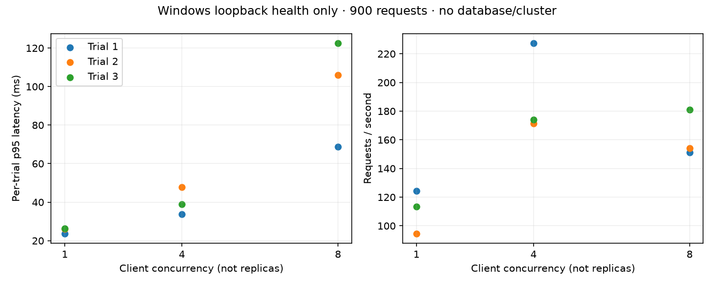

# Final release readiness

Date: 2026-11-04 (Asia/Calcutta). Repository:
[KubeSentinel-AI](https://github.com/manikantbindass/KubeSentinel-AI).
Branch: `codex/release-audit`. Target: `main`. Draft
[PR #15](https://github.com/manikantbindass/KubeSentinel-AI/pull/15).

**Verdict: NOT READY. No merge performed.** The owner authorized merging only
after all mandatory gates pass. Known HIGH/CRITICAL security failures do not
satisfy that condition. Neither branch protection nor the security policy is
bypassed. No AWS deployment, GitHub release or branch deletion is authorized.

## Mandatory gate decisions

| Gate | Decision | Evidence / required next action |
| --- | --- | --- |
| Audit all twelve phases | PASS | [Phase completion audit](PHASE_COMPLETION_AUDIT.md), with scope and remaining requirements |
| Every phase meets all required acceptance criteria | FAIL | Several phases remain PARTIAL; DevSecOps fails required security gates |
| No unresolved Critical/High security defects | FAIL | Unfixed Checkov dependency and OS findings; no CVE waiver added |
| No known source build failures | PASS | Python compile/type/lint, Go tests/vet and dashboard production build pass on audited source; clean-install final UI build verified |
| All required tests pass | BLOCKED | Local PostgreSQL skipped, Docker unavailable; latest final-source CI must complete |
| Actual frontend/backend integration | PASS | Real migrated API/Compose and browser jobs passed on `5ef44f5`; newer Insights source also passed Linux frontend/browser checks on `38e3e5a` |
| Fresh local kind deployment | BLOCKED | Docker Desktop Linux named pipe unavailable on this host; fresh Linux kind CI passed on `5ef44f5` |
| Self-healing safety and controlled recovery | PASS | Fresh isolated-recovery and real cluster bridge CI passed on `5ef44f5`; evidence does not establish broad production recovery |
| Documentation matches verified implementation | PASS | Planned/synthetic/undeployed capabilities labeled; current supplement records fixes and remaining gaps |
| Root PPTX/PDF valid and prominently linked | PASS | README preview near beginning; 25-slide editable deck, 22-page report and 25-page slide export pass structural/hash checks |
| No committed secrets found | PASS | Redacted full-history scan reported zero leaks; final commit scan must retain this result |
| CI checks pass | FAIL | `5ef44f5`: 19 successful jobs, five failed security jobs; final source recheck required |
| Merge conflicts resolved | PASS | README conflict resolved while preserving original introduction and all ancestry |
| Git history and Apache-2.0 preserved | PASS | All fetched heads are ancestors; original LICENSE blob unchanged |
| AWS validation limits documented | PASS | No real plan/apply/destroy or live EKS/ECR/Argo/OIDC proof claimed |
| Repository review/protection requirements met | BLOCKED | PR remains draft; all required checks and applicable independent reviews must pass first |

## Actual test evidence

- Python: `compileall` passed; full `pytest` reports **80 passed, one skipped**.
  Skip reason: `TEST_DATABASE_URL` unset, requiring disposable PostgreSQL.
  Ruff/format and mypy pass. The isolated migration job passes in Linux CI.
- Frontend: clean `npm ci`, lint, type-check, 20 tests in six files and production
  build pass after the Insights fix. Fresh `38e3e5a` frontend/browser CI also passes. Full npm audit reports 16 moderate tooling
  advisories; `npm audit --omit=dev` reports zero runtime advisories.
- Go: fixed dependencies verify; tests and vet pass with Go 1.26.10. Fresh
  Windows/Linux checks, operator image scan and controlled recovery CI pass.
- Terraform: fmt, bootstrap/dev/demo validate and eight provider-mocked tests pass.
  Locked Checkov has seven exact-resource expiring exceptions and zero blocked
  IaC findings; those exceptions still require independent review. No real AWS
  plan, apply or destroy was executed.
- Helm/GitOps: three chart lint checks, local/dev/prod application rendering,
  Argo schemas, 22 strict native resource schema validations and synthetic staging
  promotion pass; production files remain unchanged.
- Documents: local paths/LICENSE, Markdown, 13 Mermaid sources plus README diagram
  and PPTX/PDF/source lineage checks pass. Previous Phase 11 visual review is
  historical evidence; it is not replaced by structural validation.
- Synthetic ML: independent generate/train/evaluate reproduces predictions.
  Existing 177-window metrics remain explicitly synthetic. Eight-incident AIOps
  fixture evaluation reproduces twelve expected links and eight runbook matches.

Fresh CI on `5ef44f5` is preserved in
[check evidence](../reports/release-audit/integration-checks.json). It verifies
real Compose, migrations, kind, telemetry, browser, cluster bridge, detector and
isolated recovery flows. These separate tests do **not** establish one continuous
16-step telemetry-to-ML-to-approved-recovery-to-dashboard acceptance transaction.
That complete chain remains an acceptance gap; no platform-wide self-healing
success claim is inferred by concatenating independent passing tests.

## Security and performance limits

The fixed operator image has zero HIGH/CRITICAL scan entries. Remaining image
counts are API/detector/demo 45 each and dashboard 33; every remaining entry in
the downloaded scan has no supplied fixed version. The static scan's remaining
source dependency is `ecdsa` 0.19.2 / CVE-2024-23342 in Checkov tooling. See
[bug resolutions](BUG_AUDIT_AND_FIXES.md). Existing Terraform exceptions expire
2026-12-03. No broad suppression, scanner removal or invented safety conclusion
is used to make the checks green.

Measured performance is scoped: saved Windows health-only trials total 900
requests, per-trial p95 16.6–31.0 ms, without DB/cluster load. Synthetic inference
latency is measured serially in a warm process. One isolated recovery sample
includes approval/polling delay; it is not a recovery SLO. No measured CPU/memory,
HPA scaling, full-stack saturation, repeated native-recovery comparison or
production availability result exists. No new destructive chaos was executed.

## Prioritized remediation and exact validation path

1. **P0 security:** obtain patched supported runtimes and a Checkov dependency
   replacement/fix or independently reviewed treatment. Re-run
   `security-static` and all five `image-security` jobs; every required gate must
   pass without hidden suppressions. Preserve raw scans and SBOMs.
2. **P0 integration:** complete the final source CI, particularly browser,
   Compose/migrations, kind, telemetry and isolated recovery. Resolve defects
   demonstrated by those runs before reconsidering merge.
3. **P1 local runtime:** repair Docker Desktop/WSL Linux-engine availability
   outside the project, then run `docker --context desktop-linux info`, set
   `DOCKER_CONTEXT=desktop-linux` for the process, and use the development guide's
   Compose startup/migration/smoke commands. Do not delete project volumes or
   switch to a production database to unblock tests.
4. **P1 whole chain:** add a dedicated disposable-kind acceptance scenario that
   records all sixteen requested workflow stages in one run, including signed
   approval, verified recovery, incident resolution semantics, audit, dashboard
   update and recovery metrics. Human approval remains a mandatory step for
   risky mutations; tests must not weaken controller authorization.
5. **P1 production evidence:** certify a real OIDC tenant, secret rotation,
   backup restore, real labeled telemetry and repeated resilience/scaling tests.
   Any AWS plan or deployment needs safe credentials and explicit cost approval.
6. **Final merge:** fetch current `origin/main`, verify branch ancestry/conflicts,
   rerun affected checks, satisfy protections/reviews and inspect the final diff.
   Only then use the owner's conditional merge authorization. Verify the actual
   merge SHA on `origin/main` and its CI afterward. Do not publish a release or
   deploy AWS as part of that merge.

## OWASP API and production risk review

| Risk area | Existing boundary and remaining verification |
| --- | --- |
| Object-level authorization | Operations queries and mutations enforce configured namespace scope, target UID/version and roles; tenant-specific namespace claims remain future work |
| Broken authentication | RS256 issuer/audience/expiry checks, PKCE/state/nonce and HTTPS key transport; live provider and session-expiry behavior need tenant certification |
| Property-level authorization | Typed bounded policy/decision inputs; Kubernetes snapshots exclude credentials and deployment templates; production data-leak review remains required |
| Resource consumption | Bounded request bodies, inference queues, SQL admission, pools and mutation counters; public ingress DDoS controls and full-stack saturation remain incomplete |
| Function-level authorization | Viewer/operator/approver/admin checks live on API; UI visibility is not authorization; legacy public demo endpoints require local/network isolation |
| Sensitive business flows | Exact-plan approvals, idempotency, cooldowns, budgets and availability checks; no LLM execution authority |
| SSRF | Browser proxy allowlists routes; user input cannot choose arbitrary PromQL or upstream URLs; provider/telemetry URLs are trusted operator configuration |
| Misconfiguration | Restricted contexts, non-root images, explicit egress, scoped IAM; actual cloud network and ingress policy verification remains blocked |
| Inventory management | Versioned OpenAPI, documented legacy/operations surfaces and explicit synthetic mode; no certification that every future route inherits global auth |
| Unsafe API consumption | Typed deterministic evidence boundaries, upstream deadlines, errors and fail-closed mutations; external tenant/provider integration remains unverified |

This is a scoped engineering review, not an OWASP certification, penetration
test or claim that production exposure is safe.

## Fresh measured audit benchmark

On code commit `38e3e5a`, `python scripts/benchmark_http.py --start-api --output .cache/release-audit-health-benchmark` sent 900 loopback health requests, with three 100-request trials at concurrency 1, 4 and 8. There were zero HTTP errors; per-trial p95 ranged from **23.6 to 122.6 ms**. This is Windows/Python 3.12.4, without DB or cluster load. Larger jitter than the prior Phase 09 sample demonstrates why no improvement or production latency claim is justified.

[Raw requests](../reports/release-audit/health-loopback-raw.csv), [trial summary](../reports/release-audit/health-loopback-summary.json) and [plot source](../reports/release-audit/plot_health.py) are committed.

## Final source follow-up

The final audited SHA and check snapshot are recorded in the PR and accompanying
machine-readable evidence after the Insights patch is pushed. A snapshot cannot
claim to include a future documentation-only commit containing itself. Until
the final checks finish, pending results remain BLOCKED rather than PASS.

Current `main` was observed at `650ee4a` with `protected=false`. No protection settings were changed. This lack of repository-enforced checks is an operational risk; the audit still refuses the merge while mandatory gates fail. The five public HTTPS links/badges in README returned HTTP 200; local links and the original LICENSE also pass validation.

The dashboard runtime is being moved from the supported Debian 12 image to the official Debian 13 Node 24.22.2 image, pinned by registry digest. This targets the remaining Debian 12 critical zlib entry; no removal or clean scan is claimed until new image CI verifies it.
